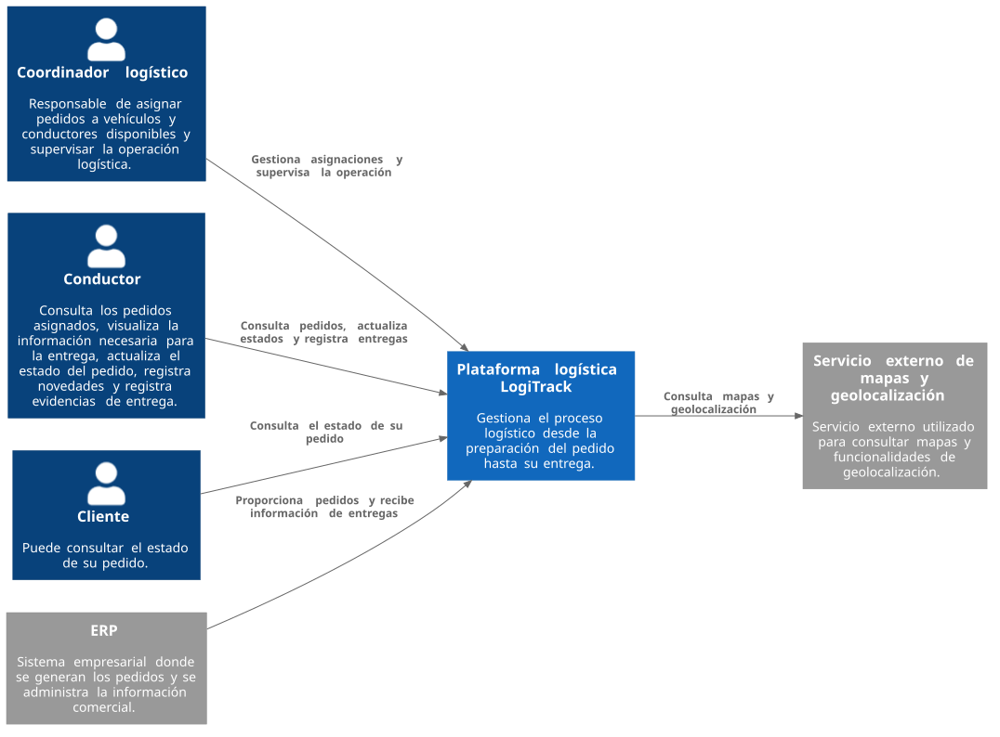
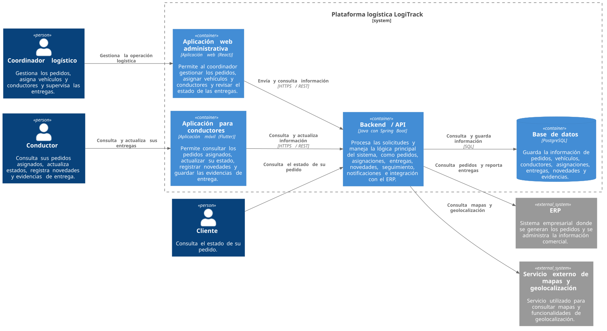
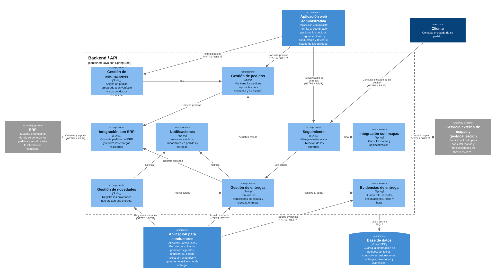
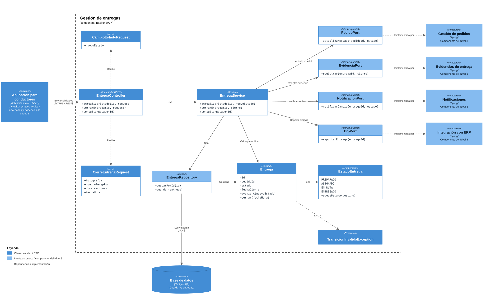

# Laboratorio - Modelo C4 para un proceso logístico
## Integrantes
- Luis Carlos Marín Mayo
- Jorge Andrés Carvajal Sepúlveda
- Nikole Herrera Ruiz
## 1. Comprensión del problema

            Elemento                                                        Decisión del equipo   
            
                                                               Plataforma de gestión logística de LogiTrack:
    Sistema que se está modelando                Sera una plataforma que permitirá gestionar el proceso de distribución de los pedidos,   
                                                desde que están preparados para ser enviados hasta que son entregados al cliente.      
                                                
                                                Coordinador logístico: Asigna los pedidos a un vehículo y a un conductor disponible.
     Actores principales                        Conductor: Consulta los pedidos que tiene asignados, revisa la información necesaria para realizar las entregas y actualiza su estado.
                                                Cliente: Puede consultar el estado de su pedido.   

                                                ERP: es donde la empresa ya genera los pedidos y administra la información comercial. 
     Sistemas externos                          La plataforma logística debe consultar los pedidos desde allí y posteriormente enviarle información sobre las entregas realizadas.
                                                Servicio externo de mapas y geolocalización: se utilizará para las funciones relacionadas con mapas y ubicación.
  
     Responsabilidad principal                  Gestionar y dar seguimiento al proceso de entrega de los pedidos, desde que están preparados hasta que son entregados al cliente, 
                                                permitiendo realizar asignaciones, actualizar estados, registrar novedades y guardar la evidencia de entrega.

     Información administrada                   Pedidos, vehículos, conductores, asignaciones de pedidos, estados de los pedidos, novedades durante las entregas, evidencias de entrega, 
                                                información de quien recibe el pedido, observaciones, fecha y hora de la entrega.    

                                                El ERP proporciona los pedidos a la plataforma logística.
                                                El coordinador logístico toma los pedidos preparados y los asigna a un vehículo y a un conductor.
                                                El conductor consulta sus pedidos asignados.
                                                El conductor realiza la entrega y va actualizando el estado del pedido.
    Principales interacciones                   Si ocurre algún problema, el conductor registra la novedad correspondiente.
                                                Cuando entrega el pedido, registra la evidencia de entrega, incluyendo fotografía, nombre de quien recibe, observaciones, fecha y hora.
                                                El cliente consulta el estado de su pedido.
                                                La plataforma informa al ERP sobre las entregas que ya fueron realizadas.
                                                La plataforma utiliza el servicio de mapas y geolocalización para las funciones relacionadas con ubicación.  

    
Respondan:    
¿Dónde termina la responsabilidad de la plataforma logística y dónde comienzan las responsabilidades de los sistemas externos?   

R//: La responsabilidad de la plataforma logística termina en todo lo relacionado con la organización y seguimiento de las entregas, como asignar los pedidos, permitir que el conductor los consulte y actualice su estado, 
registrar las novedades y guardar la evidencia de la entrega.

La responsabilidad de los sistemas externos comienza cuando se necesita información o servicios que la plataforma no maneja directamente. El ERP se encarga de generar los pedidos y manejar la información comercial de la empresa, 
mientras que el servicio de mapas se encarga de proporcionar la información relacionada con mapas y ubicación. La plataforma se comunica con estos sistemas para obtener o enviar la información que necesita.

## 2. C4 Nivel 1 - Contexto

## 3. C4 Nivel 2 - Contenedores

            | Contenedor                    | Responsabilidad                                                                                                                                             | Tecnología propuesta                   | Comunicación                                                                                  |
            | ----------------------------- | ----------------------------------------------------------------------------------------------------------------------------------------------------------- | -------------------------------------- | ----------------            ----------------------------------------------------------------------------- |
            | Aplicación web administrativa | Permite al coordinador gestionar los pedidos, asignar vehículos y conductores y revisar el estado de las entregas.                                          | Aplicación web (React).                | Se comunica con el Backend/API para enviar y consultar información.                           |
            | Aplicación para conductores   | Permite consultar los pedidos asignados, actualizar su estado, registrar novedades y guardar las evidencias de entrega.                                     | Aplicación móvil (Flutter).            | Se comunica con el Backend/API para consultar y actualizar información.                       |
            | Backend/API                   | Se encarga de procesar las solicitudes y manejar la lógica principal del sistema, como pedidos, asignaciones, entregas, novedades e integración con el ERP. | Java con Spring Boot.                  | Se comunica con las aplicaciones, la base de datos, el ERP y el servicio de mapas.            |
            | Base de datos                 | Guarda la información de pedidos, vehículos, conductores, asignaciones, entregas, novedades y evidencias.                                                   | PostgreSQL.                            | Se comunica con el Backend/API, que consulta y guarda la información.                         |
            | Servicio de seguimiento       | Permite manejar la información del estado y ubicación de las entregas.                                                                                      | Funcionalidad interna del Backend/API. | El Backend/API utiliza el servicio externo de mapas cuando necesita información de ubicación. |
            | Servicio de notificaciones    | Se encarga de las notificaciones relacionadas con los pedidos y las entregas.                                                                               | Funcionalidad interna del Backend/API. | El Backend/API             gestiona las notificaciones cuando ocurre alguna acción importante.            |

Pregunta crítica
¿Qué criterio utilizaron para decidir que un elemento debía ser un contenedor
independiente?

R//: Para decidir qué elementos serían contenedores independientes, tuvimos en cuenta la función que cumple cada uno y si era necesario separarlo de los demás para realizar su trabajo. Por eso elegimos la aplicación web administrativa, la aplicación para conductores, el Backend/API y la base de datos, ya que cada uno cumple una función diferente dentro de la plataforma. En el caso del seguimiento y las notificaciones, consideramos que por ahora pueden manejarse desde el Backend/API, porque no vemos necesario separarlos como servicios independientes para cumplir con lo que solicita el caso.

## 4. C4 Nivel 3 - Componentes

| Componente         | Responsabilidad | Dependencias |
|--------------------|---|---|
| Gestión de pedidos | Mantener los pedidos disponibles para despacho y su estado. | Integración con ERP, Base de datos |
| Gestión de asignaciones | Asignar un pedido preparado a un vehículo y a un conductor disponible. | Gestión de pedidos, Base de datos |
| Gestión de entregas | Controlar las transiciones de estado (preparado, asignado, en ruta, entregado) y cerrar la entrega. | Gestión de pedidos, Evidencias de entrega, Notificaciones, Integración con ERP, Base de datos |
| Gestión de novedades | Registrar las novedades que afectan una entrega (cliente ausente, dirección incorrecta, producto rechazado, vehículo averiado, entrega reprogramada). | Gestión de entregas, Notificaciones, Base de datos |
| Evidencias de entrega | Guardar la fotografía, el nombre de quien recibe, las observaciones, la fecha y la hora de la entrega. | Base de datos |
| Seguimiento | Manejar el estado y la ubicación de las entregas y atender la consulta del estado de un pedido. | Gestión de entregas, Integración con mapas, Base de datos |
| Notificaciones | Avisar cuando ocurre un cambio importante en un pedido o en una entrega. | Ninguna dependencia interna |
| Integración con ERP | Consultar los pedidos del ERP y reportarle las entregas realizadas. | ERP (sistema externo) |
| Integración con mapas | Consultar mapas y geolocalización. | Servicio externo de mapas (sistema externo) |

## 5. C4 Nivel 4 - Código

**Gestión de entregas** (Backend/API). Se eligió porque concentra las reglas de negocio más importantes del proceso (transiciones de estado y cierre de la entrega) y es el componente que más se relaciona con los demás.

**Responsabilidad definida en el Nivel 3:** controlar las transiciones de estado (preparado, asignado, en ruta, entregado) y cerrar la entrega.

**Dependencias definidas en el Nivel 3:** Gestión de pedidos, Evidencias de entrega, Notificaciones, Integración con ERP y Base de datos.

| Elemento de código | Tipo | Responsabilidad | Relación principal |
|---|---|---|---|
| EntregaController | Controlador REST | Recibir las solicitudes de la aplicación para conductores (actualizar estado, cerrar entrega, consultar estado) y delegarlas al servicio. | Usa EntregaService |
| EntregaService | Servicio | Coordinar el caso de uso: validar la transición, guardar la entrega y avisar a los demás componentes. | Usa EntregaRepository y los cuatro puertos |
| Entrega | Entidad | Representar una entrega y proteger sus reglas: solo cambia de estado si la transición es válida. | Tiene un EstadoEntrega |
| EstadoEntrega | Enumeración | Definir los estados (PREPARADO, ASIGNADO, EN_RUTA, ENTREGADO) y qué transiciones están permitidas. | Usada por Entrega |
| TransicionInvalidaException | Excepción | Señalar un intento de cambio de estado no permitido. | La lanza Entrega |
| CambioEstadoRequest | Objeto de transferencia (DTO) | Llevar el nuevo estado solicitado por la aplicación. | Lo recibe EntregaController |
| CierreEntregaRequest | Objeto de transferencia (DTO) | Llevar los datos del cierre: fotografía, nombre de quien recibe, observaciones, fecha y hora. | Lo recibe EntregaController |
| EntregaRepository | Interfaz (repositorio) | Guardar y consultar entregas en la base de datos. | Implementada con PostgreSQL |
| PedidoPort | Interfaz (puerto) | Pedir a Gestión de pedidos que actualice el estado del pedido. | La implementa el componente Gestión de pedidos |
| EvidenciaPort | Interfaz (puerto) | Pedir a Evidencias de entrega que guarde la evidencia al cerrar. | La implementa el componente Evidencias de entrega |
| NotificacionPort | Interfaz (puerto) | Pedir a Notificaciones que avise del cambio de estado. | La implementa el componente Notificaciones |
| ErpPort | Interfaz (puerto) | Pedir a Integración con ERP que reporte la entrega realizada. | La implementa el componente Integración con ERP |

*Nota:* los estados PREPARADO y ASIGNADO los fija Gestión de asignaciones a través de Gestión de pedidos; este componente controla el avance desde ASIGNADO hasta ENTREGADO, pero el enum incluye todos los estados para validar las transiciones con un solo criterio.

### Pregunta crítica

**¿Cómo se evidencia que las clases diseñadas realmente implementan la responsabilidad definida previamente en el componente?**

R//: Se evidencia con la trazabilidad entre el Nivel 3 y el Nivel 4: cada responsabilidad y cada dependencia del componente Gestión de entregas tiene un elemento de código que la implementa, y ningún elemento de código existe sin una responsabilidad que lo justifique. La responsabilidad principal del componente (controlar las transiciones de estado y cerrar la entrega) se materializa en `EstadoEntrega`, `Entrega` y `EntregaService`. Las dependencias del Nivel 3 (pedidos, evidencias, notificaciones, ERP y base de datos) se materializan en interfaces (`PedidoPort`, `EvidenciaPort`, `NotificacionPort`, `ErpPort` y `EntregaRepository`), de modo que el componente solo depende de contratos y no de las clases internas de los demás componentes.

| Responsabilidad o dependencia del componente (Nivel 3) | Elemento de código que la implementa (Nivel 4) |
|---|---|
| Controlar las transiciones de estado | `EstadoEntrega.puedePasarA()`, `Entrega.avanzarA()` y `EntregaService.actualizarEstado()` |
| Cerrar la entrega | `EntregaService.cerrarEntrega()` y `Entrega.cerrar()` |
| Recibir solicitudes de la aplicación para conductores | `EntregaController` |
| Responder a Seguimiento, que lee el estado | `EntregaService.consultarEstado()` |
| Responder a Gestión de novedades, que afecta el estado | `EntregaService.actualizarEstado()` |
| Dependencia: Gestión de pedidos | `PedidoPort` |
| Dependencia: Evidencias de entrega | `EvidenciaPort` |
| Dependencia: Notificaciones | `NotificacionPort` |
| Dependencia: Integración con ERP | `ErpPort` |
| Dependencia: Base de datos | `EntregaRepository` |

## 6. Uso y validación de IA
### Prompt utilizado

            Estamos desarrollando un modelo C4 de una plataforma logística.
            Hemos construido los cuatro niveles:
            1. Contexto
            2. Contenedores
            3. Componentes
            4. Código
            Revisa nuestro modelo y señala:
            - Elementos ubicados en un nivel incorrecto.
            - Inconsistencias entre niveles.
            - Responsabilidades mal definidas.
            - Componentes que parecen clases.
            - Clases que no corresponden al componente seleccionado.
            - Dependencias innecesarias.
            - Posibles problemas de separación de responsabilidades.
            No reconstruyas el modelo completo. Actúa como revisor arquitectónico y explica cada hallazgo.

### Observaciones generadas por la IA

            Observación 1. Diferencia en la responsabilidad de Gestión de entregas
            
            En el Nivel 3, Gestión de entregas aparece como responsable de controlar todos los cambios de estado, desde preparado hasta entregado. Sin embargo, en el Nivel 4 se aclara que este componente solamente controla el avance desde asignado hasta entregado, mientras que los estados anteriores son manejados por Gestión de asignaciones y Gestión de pedidos.
            
            Esto genera una pequeña inconsistencia entre la responsabilidad definida y lo que realmente implementa el componente. Se recomienda aclarar el alcance de Gestión de entregas para que quede claro desde qué momento comienza su responsabilidad y evitar que se confunda con las funciones de los otros componentes.
            
            Observación 2. Posible cruce de responsabilidades entre Seguimiento y Gestión de entregas
            
            En el Nivel 3, el componente Seguimiento se encarga de manejar el estado y la ubicación de las entregas, además de atender las consultas del estado de un pedido. Sin embargo, en el Nivel 4, EntregaService también aparece encargado de consultar el estado de las entregas mediante el método consultarEstado().
            
            Aunque ambos componentes pueden colaborar, no queda completamente claro cuál es el responsable de atender las consultas de seguimiento, lo que podría generar duplicación de responsabilidades.
            
            Se recomienda diferenciar mejor estas funciones, dejando que Gestión de entregas se encargue de actualizar los estados y que Seguimiento se encargue de consultar y mostrar esa información.
            
            Observación 3. Dependencia de Gestión de entregas con la integración ERP
            
            En el Nivel 3, Gestión de entregas depende directamente de Integración con ERP. En el Nivel 4, esta relación se representa mediante ErpPort, utilizado para reportar la entrega realizada.
            
            La dependencia está identificada, pero se podría separar mejor la responsabilidad de cerrar una entrega de la responsabilidad de comunicar posteriormente ese resultado al ERP. De lo contrario, un problema de comunicación con el ERP podría afectar el proceso de cierre.
            
            Se recomienda que el registro de una entrega completada no dependa directamente de que el ERP responda en ese mismo momento, manteniendo separadas ambas responsabilidades.
            
            Observación 4. Inconsistencia en las dependencias del componente Notificaciones
            
            En el Nivel 3, el componente Notificaciones aparece con la indicación de que no tiene dependencias internas. Sin embargo, Gestión de entregas y Gestión de novedades sí lo tienen como una de sus dependencias.
            
            Además, en el Nivel 4 se define NotificacionPort, que permite a EntregaService solicitar el envío de notificaciones cuando ocurre un cambio de estado.
            
            Esto genera una inconsistencia en la forma en que se representan las relaciones entre los componentes. Se recomienda revisar la dependencia de Notificaciones y aclarar cómo recibe las solicitudes de los demás componentes para que las relaciones del Nivel 3 coincidan con las del Nivel 4.
            
            Observación 5. Seguimiento y notificaciones representados como contenedores independientes
            
            En el Nivel 2 se incluyen Servicio de seguimiento y Servicio de notificaciones como elementos de la arquitectura. Sin embargo, en la tabla se indica que ambos son funcionalidades internas del Backend/API y no servicios independientes.
            
            Esto puede generar confusión porque se están mostrando como contenedores separados, aunque su propia descripción indica que forman parte del Backend/API.
            
            Se recomienda aclarar que estas funcionalidades se encuentran dentro del Backend/API y que, por ahora, no necesitan ser contenedores independientes. Esto también permitiría mantener una mejor relación entre el Nivel 2 y el Nivel 3, donde Seguimiento y Notificaciones aparecen como componentes.
            
### Evaluación del equipo  

            | Observación de la IA                                      | ¿Se acepta? |                   Justificación del equipo                    |
            |-----------------------------------------------------------|-------------|---------------------------------------------------------------|
            |En el Nivel 3, Gestión de entregas aparece como responsable|             |                                                               |
            | de controlar todos los cambios de estado, desde           |             |                                                               |
            | preparado hasta entregado. Sin embargo, en el Nivel 4 se  |             |                                                               |
            | aclara que este componente solamente controla el avance   |     Si      |  Estamos de acuerdo porque al revisar nuestros diagramas      |
            | desde asignado hasta entregado, mientras que los estados  |             | vimos que no estaba muy clara la responsabilidad de este      |
            | anteriores son manejados por Gestión de asignaciones y    |             | componente. En una parte parecia encargarse de todo el        |
            | Gestión de pedidos.                                       |             | proceso y en otra solamente desde que el pedido ya esta       |
            | Esto genera una pequeña inconsistencia entre la           |             | asignado. Por eso creemos que es necesario aclararlo para     |
            | responsabilidad definida y lo que realmente implementa    |             | que cada componente tenga su funcion bien definida.           |
            | el componente.                                            |             |                                                               |
            |-----------------------------------------------------------|-------------|---------------------------------------------------------------|
            | En el Nivel 3, el componente Seguimiento se encarga de    |             |                                                               |
            | manejar el estado y atender las consultas del pedido.     |             |                                                               |
            | Sin embargo, en el Nivel 4, EntregaService también        |             |                                                               |
            | aparece encargado de consultar el estado de las           |   Parcial   | Consideramos que los dos componentes si necesitan trabajar    |
            | entregas. Aunque ambos componentes pueden colaborar,      |             | con los estados de los pedidos, pero no deberian hacer        |
            | no queda completamente claro cuál es el responsable de    |             | exactamente lo mismo. Gestion de entregas debe encargarse     |
            | atender las consultas de seguimiento, lo que podría       |             | de actualizar los estados y seguimiento de mostrar esa        |
            | generar duplicación de responsabilidades.                 |             | informacion cuando alguien consulte el pedido. Por eso        |
            |                                                           |             | creemos que solo hace falta dejar mas claras sus funciones.   |
            |-----------------------------------------------------------|-------------|---------------------------------------------------------------|
            | En el Nivel 3, Gestión de entregas depende directamente   |             |                                                               |
            | de Integración con ERP. En el Nivel 4, esta relación se   |             |                                                               |
            | representa mediante ErpPort, utilizado para reportar la   |             |                                                               |
            | entrega realizada. La dependencia está identificada,      |   Parcial   | Estamos de acuerdo en que la comunicacion con el ERP es       |
            | pero se podría separar mejor la responsabilidad de cerrar |             | necesaria porque debemos enviar la informacion de las         |
            | una entrega de la responsabilidad de comunicar            |             | entregas realizadas. Sin embargo, creemos que eso no deberia  |
            | posteriormente ese resultado al ERP. De lo contrario,     |             | impedir que la plataforma registre una entrega cuando el      |
            | un problema de comunicación con el ERP podría afectar     |             | ERP tenga algun problema. Por eso consideramos que ambas      |
            | el proceso de cierre.                                     |             | funciones deben estar separadas para que el proceso pueda     |
            |                                                           |             | continuar normalmente.                                        |
            |-----------------------------------------------------------|-------------|---------------------------------------------------------------|

## 7. Auditoría de coherencia

El grupo 3 que debia hacernos la AUDITORIA, no nos la realizo y por ende este punto no pudo ser completado

## 8. Conclusiones

1. Con este trabajo entendimos que cada nivel del modelo C4 muestra una parte diferente del sistema. El sistema representa toda la plataforma logística; los contenedores son sus partes principales, como el Backend y las aplicaciones; los componentes representan las funciones que tiene cada parte, y el nivel de código muestra cómo se pueden implementar esas funciones mediante clases, servicios e interfaces.

2. La mayor dificultad la tuvimos al pasar del nivel de componentes al nivel de código, porque debíamos relacionar las funciones que habíamos definido con elementos concretos. Esto se vio principalmente en Gestión de entregas, donde tuvimos que identificar qué elementos se encargan de controlar los estados, cerrar la entrega y comunicarse con los demás componentes.

3. De las observaciones de la IA, aceptamos la primera porque nos ayudó a identificar que no estaba suficientemente claro desde qué estado comenzaba la responsabilidad de Gestión de entregas. Las otras dos las aceptamos parcialmente, ya que estamos de acuerdo en que Seguimiento y Gestión de entregas deben tener funciones diferentes y que cerrar una entrega no debería depender de que el ERP responda en ese momento. Sin embargo, consideramos que ambos componentes deben seguir trabajando juntos y que la plataforma debe comunicar al ERP las entregas realizadas.

4. La coherencia entre los niveles se evidencia al relacionar las responsabilidades definidas en los componentes con los elementos de código que las llevan a cabo. Por ejemplo, Gestión de entregas se representa en el nivel de código mediante `EntregaService`, `Entrega` y `EstadoEntrega`, mientras que sus dependencias se representan mediante interfaces como `PedidoPort`, `EvidenciaPort` y `ErpPort`. A pesar de esto, la revisión con IA nos permitió identificar algunos aspectos que debemos aclarar para que las responsabilidades estén mejor definidas y los niveles coincidan correctamente.
